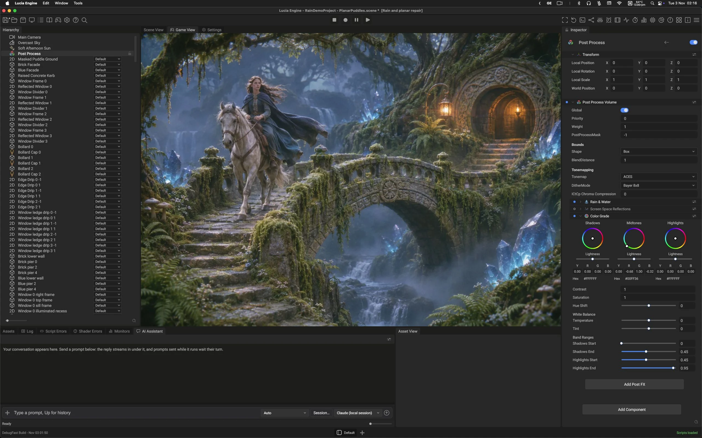

<p align="center">
  
</p>

# Lucia Engine

Lucia Engine is an open-source game engine sharing its foundations with [Open Engine](https://github.com/Game-Crafters-Guild/OpenEngine).

Written in C++20, it combines hot-reloadable C# scripting, an archetype ECS, and an editor whose UI is built from XML and CSS.

**Platforms:** Windows x64 and ARM64 (primary), macOS on Apple Silicon and Intel (native Metal, with a MoltenVK fallback), Linux, Steam Deck.



## Highlights

- **Renderer**: native Metal and Vulkan backends with GPU-driven rendering: a render graph with automatic barriers and resource aliasing, clustered Forward+ lighting, cascaded shadow maps, schema-driven materials with composed shader variants, physical light units with an HDR pipeline, instanced draw batching, camera-relative rendering for planet-scale coordinates, reverse-Z depth.
- **ECS**: archetype-based with chunked SoA storage: cache-coherent iteration, chunk-level change tracking, parallel queries, deferred commands, generational handles.
- **C# scripting**: CoreCLR (.NET 10) embedded in the engine. Save a script and it recompiles through a resident Roslyn compile server and hot-swaps into the running process, with no restart.
- **Editor**: a dockable multi-window editor. All editor UI is XML and CSS with live hot reload, and the same UI runtime ships in games (flexbox layout through Yoga, GPU text rendering).
- **Assets**: GUID-based identity, parsers for glTF, KTX, audio, scenes, materials and animations, dependency-graph hot reload, async priority streaming.
- **World systems**: Jolt physics, Recast/Detour navigation, GPU-adaptive CBT terrain for large worlds, skeletal animation with humanoid retargeting.
- **AI-assisted development**: a bundled MCP server lets AI agents drive the running editor: query scenes and ECS state, read logs, take screenshots, inspect the render graph, trigger GPU captures, run tests. See [docs/MCP_SETUP.md](docs/MCP_SETUP.md).

## Build

### macOS (Apple Silicon)

Install full Xcode and finish its first-launch setup, then install the [.NET 10 SDK](https://dotnet.microsoft.com/en-us/download/dotnet/10.0) for macOS Arm64. With [Homebrew](https://brew.sh/) available:

```bash
brew install cmake ninja pkg-config autoconf autoconf-archive automake libtool molten-vk
git clone https://github.com/luciaengine/lucia-engine.git
cd lucia-engine
cmake --preset macos-arm64-ninja
cmake --build --preset macos-arm64-ninja --target Editor -j 8
open build/macos-arm64-ninja/bin/DebugFast/Apps/Editor/Editor.app
```

On an Intel Mac, use `macos-x64-ninja` in both commands and the output path, and install the macOS x64 .NET SDK. These presets build **DebugFast**. Native Metal is selected by default; MoltenVK is also required by the default app-bundle staging for the Vulkan fallback. An installed [Vulkan SDK](https://vulkan.lunarg.com/) can supply MoltenVK instead of Homebrew. See [macOS setup](BUILD.md#macos) for prerequisites and the optional Xcode workflow.

### Windows

Prerequisites on Windows: Visual Studio 2026 with the *Desktop development with C++* workload (includes CMake, Ninja and Git), the .NET 10 SDK and a Vulkan-capable GPU driver.

```bat
cd /path/to/lucia-engine
cmake --preset vs2026-x64-local
cmake --build --preset vs2026-x64-local --config DebugFast --target Editor -j 12
build\vs2026-x64-local\bin\DebugFast\Apps\Editor\Editor.exe
```

### Linux (x64)

Install the [.NET 10 SDK for your distribution](https://learn.microsoft.com/en-us/dotnet/core/install/linux). Use a C++20 compiler, CMake 3.25 or newer, and Ninja. On Ubuntu 24.04 or newer, install the native build and windowing dependencies:

```bash
sudo apt update
sudo apt install build-essential cmake ninja-build pkg-config git curl zip unzip tar \
  autoconf autoconf-archive automake libtool \
  libxinerama-dev libxcursor-dev xorg-dev libglu1-mesa-dev libwayland-dev
```

Install a Vulkan-capable driver for your GPU. For Intel or AMD GPUs on Ubuntu, use `sudo apt install mesa-vulkan-drivers vulkan-tools`. NVIDIA GPUs need a compatible NVIDIA driver. The default windowing backend uses X11, so a Wayland desktop needs XWayland.

```bash
git clone https://github.com/luciaengine/lucia-engine.git
cd lucia-engine
cmake --preset linux-x64-local -DCMAKE_BUILD_TYPE=DebugFast
cmake --build --preset linux-x64-local --target Editor -j 8
./build/linux-x64-local/bin/DebugFast/Apps/Editor/Editor
```

Run the `Editor` launcher shown above. It starts the native executable with the supported runtime defaults. Other distributions can use the equivalent packages listed in [Linux setup](BUILD.md#linux).

The first configure bootstraps vcpkg and builds the third-party dependencies once (expect tens of minutes); every build after that is incremental. macOS and Linux build the same Editor through their own presets (`macos-arm64-ninja`, `linux-x64-local`); platform prerequisites, the Ninja fast build, Steam Deck, tests and troubleshooting are in [BUILD.md](BUILD.md). With the editor running, [Your first project](docs/first-project.html) creates a project, saves a scene and exports a game.

## Repository layout

```
Engine/               Core engine library
  Modules/            Subsystem libraries: Rendering, ECS, Physics, UI, AssetDatabase, JobSystem, ...
Apps/Editor/          The editor application (C++ with C# integration)
Apps/Player/          Standalone game player
Managed/              C# side: CoreBridge, HotReload, Scripting.ABI, CompileServerHost, ...
Examples/             Standalone demo applications
Tests/                Integration tests (module unit tests live next to each module)
mcp/                  MCP server for AI agent and editor integration
docs/                 Documentation (start at docs/index.html)
Tools/                Developer tools and scripts
dependencies/         Auto-provisioned vcpkg checkout (gitignored)
build/                Build trees, one per preset (gitignored)
```

## Contributing

[CONTRIBUTING.md](CONTRIBUTING.md) and [CodingStyle.md](CodingStyle.md). The team's working notes are not part of the repository.

## License

Lucia Engine is available under the [MIT License](LICENSE). See [third-party notices](THIRD_PARTY_NOTICES.md) for Open Engine attribution and its preserved license notice. The people behind the engine are named in [AUTHORS.md](AUTHORS.md). Third-party code keeps its own license, stated next to it: the libraries under `Engine/Source/ThirdParty/` and `ThirdParty/`, the benchmark sources under `Tools/Benchmarks/ECS/third_party/`, and the dependencies installed through vcpkg.

## Tests

Tests are Google Test executables, one per module; [BUILD.md](BUILD.md) lists how to build and run them. Two package-manager tests clone a live git repository and are skipped unless `GE_GIT_E2E=1` is set: `PackageGitResolution.LiveEndToEndAgainstGameEnginePackagesRepo` and `PackageManagementLive.AddRepinCheckAgainstGameEnginePackagesRepo`.
