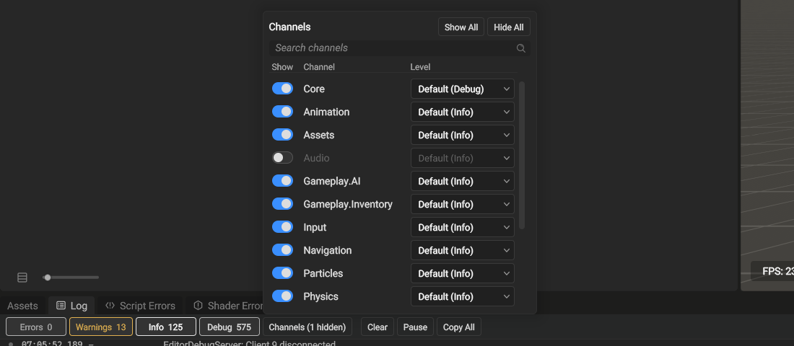

Open the **Log** panel and select **Channels** to show or hide registered channels.
The channel filter combines with the existing search and severity filters. All
three conditions must match for a line to appear. Copy without a selection
copies the lines that pass those filters.

The channel list has its own search. **Show all** and **Hide all** apply to the
channels that match that search. Closing the list keeps its visibility choices
for the current panel. Hiding a channel keeps its stored lines.

Each channel also has a minimum logging level. This controls whether the logger
creates new records. It does not remove records already stored in the panel.
**Default** uses the stricter of the global level and the channel's declared
level. An explicit channel level overrides that threshold. Global **Off** stops
all channels. These settings last for the current process.

## Declare a channel

Declare a channel once in the owning module's header. Its first call registers
its name. Registrations with the same name share one channel across modules.
Names have at most 63 UTF-8 bytes. A process has at most 256 channels, including
**Core**.

Channel handles belong to their logger state. A host or module that calls
`Logger::Log::RedirectToSharedState` must redirect before registering channels
or using `GE_LOG`. Registration can then precede logger initialization.

```cpp title="Declare and use a gameplay channel"
#include "Logger/LogChannel.h"

namespace MyGame
{
GE_LOG_CHANNEL(GameplayLog, "Gameplay", Info)

void ReportSpawn(int entityCount)
{
    GE_LOG(GameplayLog, Info, "Spawned {} entities", entityCount);
}
}
```

`GE_LOG` does not evaluate format arguments when the channel rejects the level.
Trace and Debug calls are compiled out when debug instrumentation is disabled.
Critical records flush to the sinks before the call returns.

The channel registers when its accessor runs the first time. Nothing lists the channels in one place. Each DLL that calls the accessor registers the name again and gets the same channel. Two modules that declare the same name write to one channel, and the first declaration's default level applies. A process can register up to 256 channels.

## Log on a channel

`GE_LOG` takes the accessor, a level without its scope, and a `std::format` string with its arguments. The compiler checks the format string.

```cpp title="Log a warning on the Inventory channel"
#include "Inventory/InventoryLog.h"

GE_LOG(Inventory::InventoryLog, Warning, "slot {} holds {} items, the limit is {}", slot, count, limit);
```

When the channel does not pass the level, `GE_LOG` formats nothing and does not evaluate the arguments. Trace and Debug calls compile to nothing when the engine is built in a configuration other than Debug and DebugFast, such as Release. The configuration of the engine decides this, not the configuration of the code that logs.

`LOG_INFO`, `LOG_WARNING` and the other `LOG_` macros log on the `Core` channel with the same source information. They are in `Logger/LogChannel.h` too, so a file that only logs needs no other logger header. The `Logger::Log::Info` family of functions also logs on `Core`, without the source.

## The level of a channel

A record reaches the sinks when its level is at or above the channel's level:

- A channel that you set a level for uses that level. This is true also when the global level is stricter.
- A channel with no level of its own uses the stricter of the global level and its default level. A channel declared at Warning stays quiet while the global level is Info. `Core` has the default level Trace, so it follows the global level.
- When logging is off (before the logger starts, or after it stops), every channel is off.

Set or clear a channel's level from code with `Logger::Log::SetChannelLevel`:

:::::tabs
::::tab[C++]

```cpp title="Logger/Logger.h"
static void SetChannelLevel(std::uint16_t channel, std::optional<LogLevel> level);
```

```cpp title="Turn on Debug for one channel, then return it to the global level"
#include "Logger/Logger.h"

Logger::Log::SetChannelLevel(Inventory::InventoryLog().Index, Logger::LogLevel::Debug);
Logger::Log::SetChannelLevel(Inventory::InventoryLog().Index, std::nullopt);
```

::::
::::tab[C#]

:::caution[C# binding pending]
No managed call sets a channel's level yet. The native call is `Logger::Log::SetChannelLevel`. Scripts log on the `Core` channel through `Console.WriteLine`.
:::

::::
:::::

The change applies to the next log call on every thread.

## Filter the Log panel

Each line of the Log panel shows its channel after the time. A line on `Core` shows a dash in the channel column; the file log, the console and copied lines show no channel for `Core`. The **Channels** button opens the list of every registered channel, `Core` first and the others by name.

- Type in the search field at the top to list only the channels whose name contains the text. The line under the list counts them, for example **2 of 15 channels**. Escape clears the search; a second Escape closes the list.
- The toggle in the **Show** column shows or hides the lines of the channel. The button reads **Channels (1 hidden)** while a channel is hidden, and the counts beside the severity buttons leave out hidden lines. **Show All** and **Hide All** act on the channels the list shows.
- The **Level** column sets the level of the channel. **Default** removes the channel's own level, so the channel uses the stricter of the global level and its default level; the item shows that level, for example **Default (Info)**. **Trace** to **Off** set the channel's own level, as `SetChannelLevel` does.



*The Channels list with Audio hidden: its name and its level dim.*

The search field has a **Channel** scope that matches the channel name. When you select a line, the detail pane shows its channel beside the severity and the time, and the source button opens the file at the line that logged it.

The file log and the console print the channel name after the level for every channel except `Core`.
